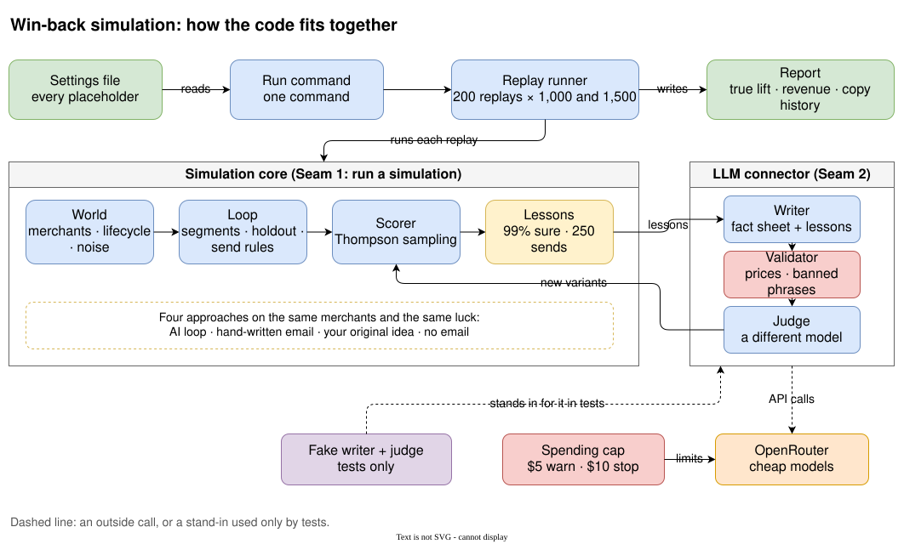
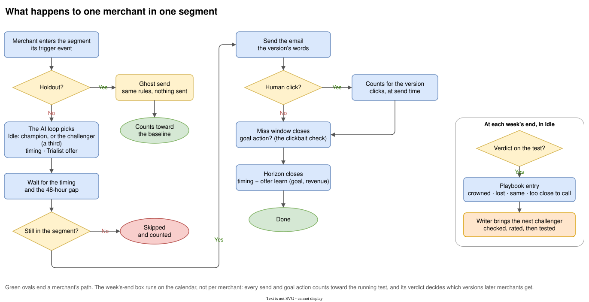
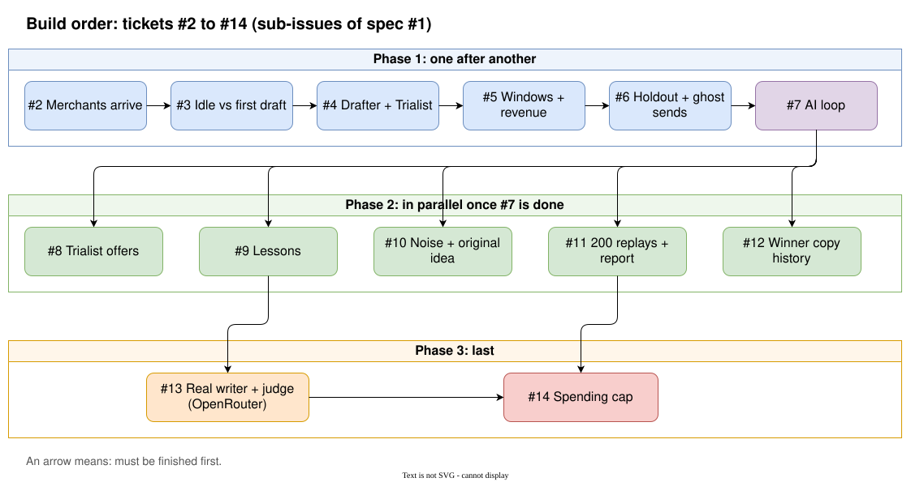
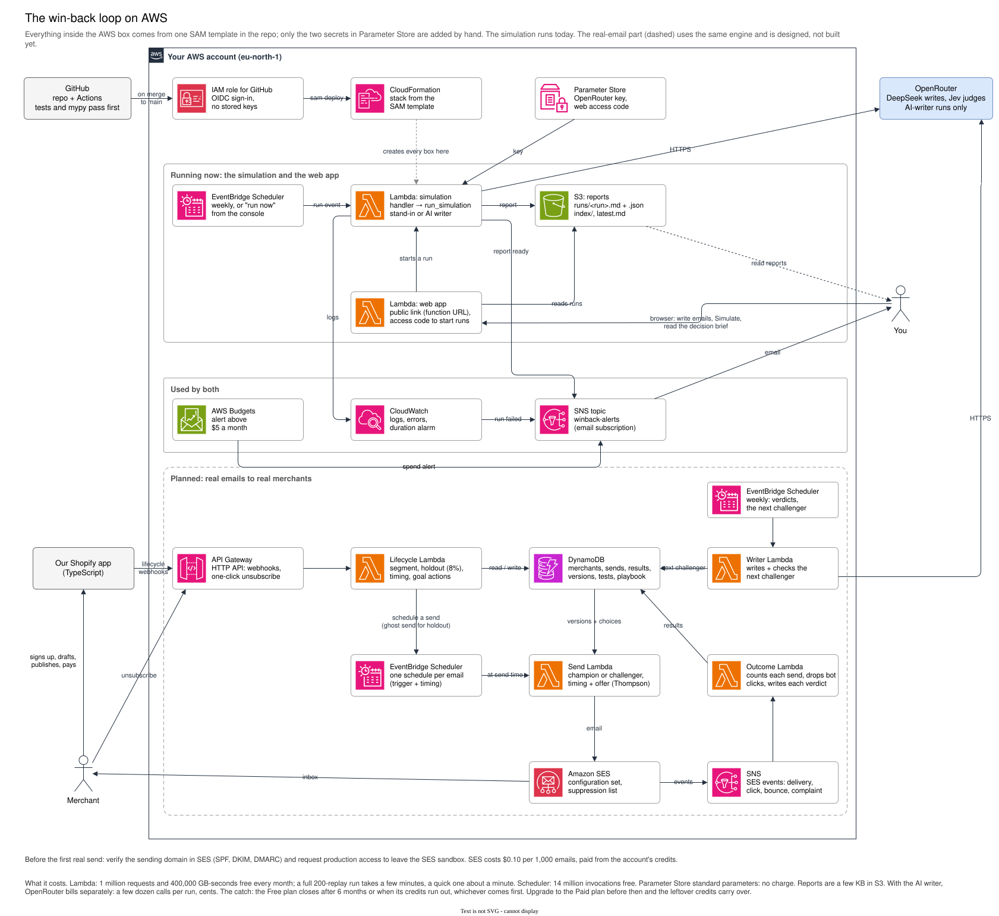

# Win-back AI loop

An email loop that wins back merchants who stall in our store-cloning Shopify app: they sign up and do nothing (**Idle**), save a draft but never publish (**Drafter**), or publish but never pay (**Trialist**). Your own email is version 0. An LLM writes the next version, the champion's email with one change and a hypothesis; it is checked against a fact sheet, tested against the champion on real clicks, and every test's verdict, won or lost and why, goes into a playbook the writer reads next.

**Milestone 1** is a simulation: made-up merchants, no real email. It answers whether the loop beats one good hand-written email at our real volume, and whether what it concludes is true.

- Spec: [#1](https://github.com/Mo3azAqeed/Win-back-AI-loop/issues/1); its tickets, done and next, are in the build order below
- Glossary: [`CONTEXT.md`](CONTEXT.md) · Decisions: [`docs/adr/`](docs/adr) · Research: [`docs/research/win-back-ai-loop.md`](docs/research/win-back-ai-loop.md)
- How the work is run, as stories: [`docs/technical-product-manager-discussion.md`](docs/technical-product-manager-discussion.md)
- Throwaway prototype: [`prototypes/win-back-sim.prototype.html`](prototypes/win-back-sim.prototype.html) (open it in a browser)

## Web app

Each deploy also publishes a web app: write your three emails, press Simulate, then read the decision brief: the journey, your email against the AI loop's champion and why it won, the week-by-week timeline, and every version and test (the playbook). Pick **AI writer** to have DeepSeek write each new version and Jev judge it, through OpenRouter; the stand-in list is the free default. Its link is the stack's `WebAppUrl` output; setting it up takes two steps (see [`docs/aws-setup.md`](docs/aws-setup.md), step 8).

## How the AI loop works

What the writer, checks, judge and test each do, and why the judge is a different kind of model from the writer: [`docs/ai-loop.md`](docs/ai-loop.md).

## How the code fits together

## What happens to one merchant

## Build order

## Running on AWS

How the simulation runs itself on AWS, and how real emails go out later: [`docs/aws.md`](docs/aws.md) (what changes in the code, and what the free account covers). Built in ticket #17; to switch it on, follow the one-time [AWS setup](docs/aws-setup.md).

The diagrams are `.drawio.svg` files: GitHub shows them as images, and you can open and edit them directly in [draw.io](https://app.diagrams.net).
