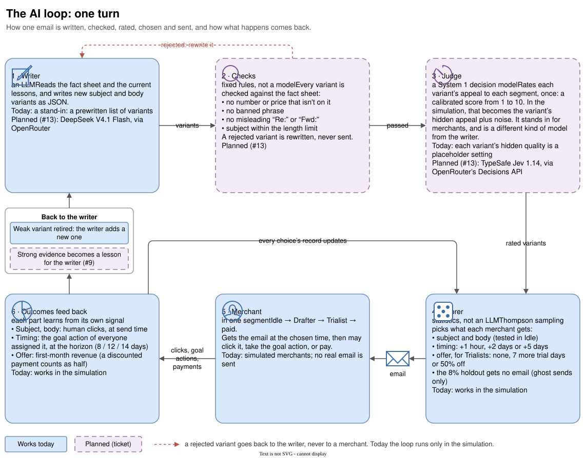

# How the AI loop works

One turn of the loop: a writer drafts email variants, fixed checks throw out anything untrue or misleading, a judge rates how appealing each variant is, and a scorer picks what each merchant gets. What merchants then do feeds back into the scorer, and, through the playbook of finished tests, into the writer.

Today the scorer, a stand-in writer (a prewritten list of variants) and the simulation work. The real writer, the checks and the judge come in #13; lessons come in #9.

## Three roles, kept apart

- **Writer (an LLM).** Reads the fact sheet ($40/month, store cloning, the section builder, the 7-day trial, the three offers and their lines, your first drafts) and the current lessons, and returns new subject and body variants as JSON. Planned: DeepSeek V4.1 Flash via OpenRouter.
- **Judge (a System 1 decision model).** Only used in the simulation, where it stands in for merchants. It rates each variant's appeal to each segment once, from 1 to 10, and the simulation turns that rating into the variant's hidden appeal plus random noise, so the judge is never treated as always right. Planned: TypeSafe Jev 1.14 via OpenRouter's Decisions API.
- **Scorer (statistics, not an LLM).** In Idle, a test of the champion version against one challenger at a time; Thompson sampling over timing and, for Trialists, offer. It decides what each merchant gets and keeps every choice's record. The 8% holdout never gets an email; the scorer only picks a ghost send time for them.

The writer writes and the scorer chooses ([ADR 0002](adr/0002-llm-writes-scorer-chooses.md)). We don't let the LLM pick from a log of wins and fails, because email outcomes are noisy and sparse: an LLM reads patterns into a handful of results, and nobody could tell real improvement from chance. With a scorer, every variant has a measured record, and every lesson carries the evidence behind it.

Between writer and judge sit **fixed checks**, not a model. A variant is rejected and rewritten, never sent, if it has a number or price that isn't on the fact sheet, a banned phrase (such as "copy any store"), a misleading "Re:" or "Fwd:", or a subject over the length limit.

## Why a System 1 model judges and an LLM writes

The two jobs are different, so they get different kinds of model.

**Writing needs an LLM.** A variant is new prose built from the fact sheet and the lessons. Only a generative model does that. DeepSeek V4.1 Flash is cheap (about $0.07–0.23 per million input tokens and $0.50–0.90 per million output tokens, depending on the provider), has a 1M-token context, and returns structured JSON. A draft is about 2,000 tokens in and 200 out, so writing costs cents per run.

**Judging is a narrow, typed decision**: one score on a rubric. A System 1 model answers that with calibrated probabilities over the scores 1 to 10 instead of free text. That gives us three things:

1. **The rating maps straight onto the simulation.** A score distribution over 1–10 turns directly into hidden appeal plus noise. There is no prose to parse and no "7, but..." to interpret.
2. **It is fast and cheap.** Per its OpenRouter page: $0.042 per million input tokens, free output, about 0.1 s per answer.
3. **It can't share the writer's biases.** It is a different kind of model, not a sibling of the writer. The spec already requires the judge to be a different model from the writer, so the judge isn't grading its own homework; the run will refuse to start if they are the same.

**Cost per full run.** About 18,000 judgements of roughly 1,500 tokens (200 replays × 2 starting sizes) come to about $1 with Jev, against roughly $2–4 with a cheap chat model. Both are well under the $10 cap per run, so cost isn't the main reason. The main gain is rating quality and predictability.

**Caveats.**

- Jev runs on OpenRouter's Decisions API, which is in alpha (`/api/alpha/decisions`), not on the chat endpoint the writer uses. The judge needs its own small connector, behind the same writer-and-judge interface, and the alpha API may change.
- It has one provider, so there is no second source if the model or the API changes.
- The deterministic checks stay whatever model writes. A better writer doesn't make them optional.

## What the scorer learns from

Each part of the email learns from a different signal, at a different time ([ADR 0003](adr/0003-what-each-part-of-the-email-learns-from.md)).

| Slot | Learns from | When |
|---|---|---|
| Version: subject and body (Idle) | Human clicks (scanner clicks left out), with the goal action as a check against clickbait | Clicks at send time; goal actions when each email's 3-day miss window closes; verdicts at week ends |
| Timing: +1 hour, +2 days, +5 days (every segment) | The goal action of every merchant assigned it, including those who acted before the email went out | When the horizon closes: 8 days for Idle, 12 for Drafter, 14 for Trialist, from the trigger event |
| Offer: none, 7 more trial days, 50% off (Trialists) | First-month revenue; a discounted payment counts as half | When the 14-day horizon closes |

- Subjects and bodies are tested in Idle only. Drafters and Trialists send their own first drafts until the real writer gives them variants of their own ([ADR 0005](adr/0005-each-segment-sends-its-own-words.md)).
- Idle runs one test at a time: the champion (at first v0, your email) against a challenger (the champion with one part changed, and a hypothesis), which gets a third of Idle's emails ([ADR 0007](adr/0007-idle-tests-whole-versions-champion-against-challenger.md)).
- A test always ends: the challenger won on clicks without clearly fewer goal actions (crowned), the champion won, the two are the same (within 1 click point), or after 2 weeks or 1,000 emails for either it is too close to call and the version ahead on clicks stays (kept, not proven). Each needs 120 sends and 90% certainty for a verdict.
- Every test writes a playbook entry: both versions, the hypothesis, the evidence, the ending and a one-line conclusion. With every version secretly identical, 5 of 140 tests (4%, 20 seeds) claimed a winner; when a test is too close to call the version ahead stays, and its entry says it was kept, not proven.
- The discount only works through the email's link ([ADR 0006](adr/0006-the-discount-works-only-through-the-emails-link.md)), so only a Trialist who clicked before paying pays half.
