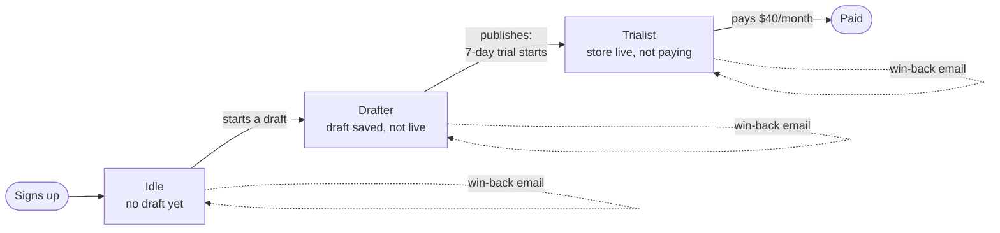
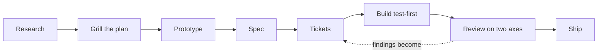
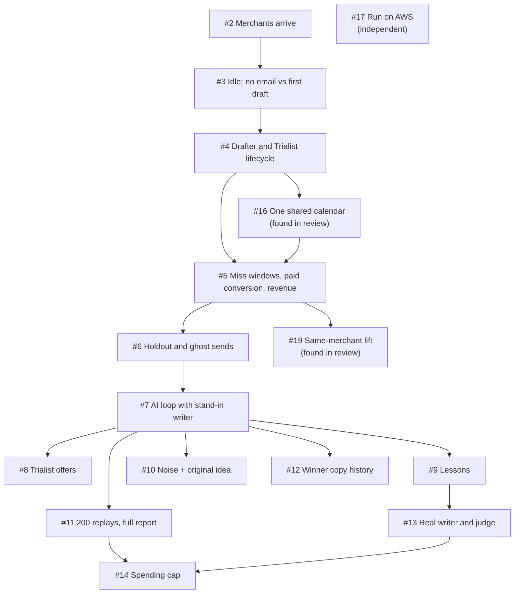
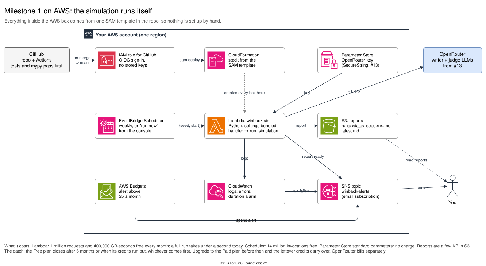
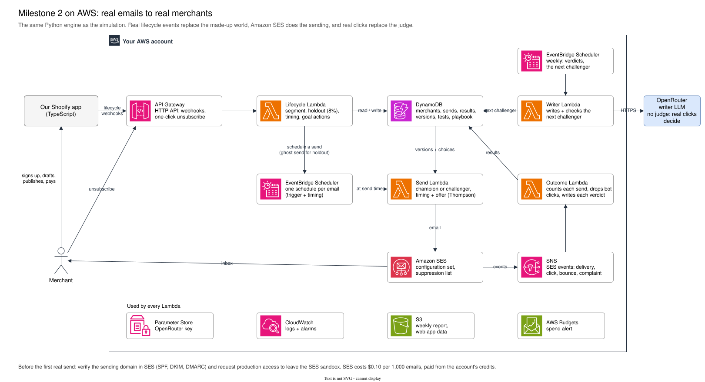

# Technical product manager notes: Win-back AI loop

How this project was run, told as stories. I acted as the technical product manager and project manager. An AI coding agent (Claude Code) did the engineering under my direction: I owned the problem, the decisions, the breakdown into tickets, the definition of done and what shipped. This file is the record I use to explain how the work was managed. It grows with every ticket.

- **Repo:** [Mo3azAqeed/Win-back-AI-loop](https://github.com/Mo3azAqeed/Win-back-AI-loop)
- **Spec:** [#1](https://github.com/Mo3azAqeed/Win-back-AI-loop/issues/1)
- **Glossary:** [`CONTEXT.md`](../CONTEXT.md). **Decisions:** [`docs/adr/`](adr)

---

## 1. The problem

We run a Shopify app that lets merchants clone a store, edit it, publish it, and pay $40 a month after a 7-day free trial. Many merchants stall before they pay, and email is our only channel to reach them. The idea: an LLM writes win-back emails, a statistical scorer decides which email each merchant gets, and every outcome feeds back so the emails get better.

Before sending a single real email, I needed answers to two questions:

1. Does an AI loop actually beat one good hand-written email at our real volume (1,000–1,500 merchants, growing 10% a week slowing to 8%)?
2. Are the "lessons" it learns true, or is it fooling itself with noise?

So milestone 1 is a **simulation**: made-up merchants with known hidden behaviour, so we can measure the *true* effect of each approach, which real data can never give us.

## 2. The user flow

The merchant's journey is the backbone of everything. Each stall point is a segment with its own goal and its own email.

| Segment | Clock starts at | Goal | Judged over (horizon) | Email scored after (miss window) |
|---|---|---|---|---|
| Idle | signup | start a draft | 8 days | 3 days after the email |
| Drafter | latest draft save | publish | 12 days | 7 days after the email |
| Trialist | publish | pay | 14 days | 14 days after publishing |

Rules every email obeys: one segment at a time, one email per segment, 48 hours between emails, skip the email if the merchant already moved on. 8% of merchants are held out for life and never emailed: they are the baseline.

---

## 3. The workflow, step by step

The work moved through eight stages. Each one produces a durable artifact, so nothing important lives only in a chat.

### 3.1 Research against primary sources

**What:** before designing anything, we checked how email signals really behave, using vendor docs, RFCs and Shopify's terms. No blog summaries.
**Artifact:** [`docs/research/win-back-ai-loop.md`](research/win-back-ai-loop.md)

**What it changed:** my original idea scored subject lines by opens and bodies by clicks. The research showed opens are unreliable: Apple Mail Privacy Protection fires fake opens, and security scanners click links. Amazon SES flags likely-bot events (`isBotEvent`). It also surfaced a hard constraint: Shopify's partner terms require a merchant's consent before you email them. Research isn't box-ticking; it moved the design before a line of code existed.

### 3.2 Grill the plan

**What:** a long round of pointed questions (over 30) about every fuzzy part of the plan. Each answer was written down straight away: terms in a glossary, hard choices in decision records.
**Artifacts:** [`CONTEXT.md`](../CONTEXT.md) (glossary), [ADR 0001](adr/0001-python-engine-typescript-integration.md), [ADR 0002](adr/0002-llm-writes-scorer-chooses.md)

**Examples of what got settled:**
- The trial starts at **publish**, not at signup.
- 8% holdout, kept for life.
- 48 hours minimum between emails.
- Python for the engine, TypeScript later for the app integration.
- The LLM **writes** variants but never **chooses**; a statistical scorer chooses (ADR 0002).
- Keep it to three things to learn (timing, subject, body with its call to action), plus offers for Trialists.

**Why it matters:** a shared vocabulary is the cheapest way to stop a team building the wrong thing. "Conversion" alone meant three things; the glossary forces one word per idea ("goal action", "paid conversion") and lists words to avoid.

### 3.3 Prototype the riskiest assumption

**What:** a throwaway, single-file browser simulation, built to be deleted.
**Artifact:** [`prototypes/win-back-sim.prototype.html`](../prototypes/win-back-sim.prototype.html)

**What it found:** the design as first agreed barely beat a hand-written email. Over 40 replays, the AI loop won about 55% of the time for Idle, 40% for Drafter and 60% for Trialist. Most merchants who reach their goal would have done so anyway, so "did they reach the goal?" was too weak a signal to learn from at our volume. The prototype also exposed three traps:

- **Timing bias:** judging timing by "did they act in the window after the email" gave early emails credit for merchants who would have acted anyway.
- **False lessons:** a loose lesson rule wrote lessons that were all false when every email was secretly identical.
- **Discounts that lose money:** aiming Trialists at "most paying" handed discounts to merchants who would have paid full price.

**What changed:** subjects and bodies now learn from human clicks, which only an email can cause. That lifted AI wins to about 70–80% for Idle. Timing is judged on everyone assigned, counted from the trigger. Lessons need 99% certainty and 250 sends per variant. Trialist offers are rewarded by revenue. All of this went into [ADR 0003](adr/0003-what-each-part-of-the-email-learns-from.md). The prototype cost an afternoon and saved building the wrong system.

### 3.4 Write the spec

**What:** one GitHub issue ([#1](https://github.com/Mo3azAqeed/Win-back-AI-loop/issues/1)) holding the problem, the solution, 47 user stories, the implementation decisions, the testing decisions and what is out of scope.

**The two sections people skip, and shouldn't:**
- **Testing decisions:** we agreed *where* tests live before any code. There is one main seam: "run a simulation with these settings and this seed, get results". Tests only touch that seam, so the internals can be rebuilt freely.
- **Out of scope:** sending real email, choosing an email provider, Shopify billing, consent capture, and more. Writing these down prevents scope creep from both sides.

### 3.5 Break it into tickets

This is the core of the job, so it has its own section (4) below.

### 3.6 Build test-first

Each ticket was built red then green: write a failing test at the agreed seam, write just enough code to pass, repeat. The tests use **hand-worked numbers**, for example "1,000 merchants × 10% = 100 signups in week 1", not numbers copied out of the code. A test that recomputes the answer the way the code does can never disagree with it.

### 3.7 Review on two axes

Every ticket got two independent reviews, run in parallel:
- **Standards:** does the code follow the repo's own rules and glossary, and is it clean?
- **Spec:** does it do what the ticket asked, no more, no less, and is anything subtly wrong?

They are kept separate on purpose: code can follow every convention and still build the wrong thing, or build the right thing badly. Findings were fixed before the ticket counted as done.

### 3.8 Ship

Work lands on `main` through pull requests. CI runs the tests, the type checker and the AWS template lint on every PR. Since #17, a merge to `main` also deploys to AWS.

---

## 4. How I broke the spec into tickets

### Philosophy

1. **Vertical slices, not layers.** A ticket never says "build the database" or "build the scorer". Each one is a thin slice through the whole system that changes what the report shows. You can run it, see it and test it on its own. The first ticket, "Merchants arrive", only made merchants appear week by week, but it ran end to end: settings in, report out.
2. **Tracer bullets first.** The early slices are deliberately simple (no email vs one hand-written email) so the plumbing is proven before the clever part (the AI loop) arrives.
3. **Every ticket has acceptance criteria you can test,** and at least one named test, for example "with the email's effect set to zero, true lift is exactly zero". That one proves the approaches share the same merchants and luck.
4. **Explicit dependencies.** Each ticket lists what it is "Blocked by". The graph tells you the order and what can run in parallel.
5. **Size so a ticket fits in one sitting.** When two tickets looked too big, I asked for them to be split.
6. **Ask for the thing you'll actually look at.** I asked for our first drafts to be written up front, and for a ticket ([#12](https://github.com/Mo3azAqeed/Win-back-AI-loop/issues/12)) showing how the winning copy changes week by week. That makes the AI's work visible to a non-engineer.
7. **Labels say who can pick it up.** `ready-for-agent` means it is fully specified; `ready-for-human` means it needs a person's judgment.

### The ticket map

The graph is a straight line through #7, then fans out. That was intentional: everything before the AI loop is foundation and has to be right in order; after it, five tickets can be worked in parallel.

### Tickets that weren't in the original plan

Two tickets came out of reviews, not the spec. That is normal and healthy. The skill is to make them visible tickets, rather than quietly widening the one in progress.

- **#16 (one shared calendar):** after #4, review showed the engine played out each merchant's whole life one at a time. Fine for one hand-written email, fatal for an AI loop that must only learn from results that already happened. It also cut off the 30-day payment window at a fixed run end. I made it a ticket and put it in front of #5.
- **#19 (same-merchant lift):** the whole-codebase review found that later segments compared different groups of merchants, which could show the email "hurting" when it helped. It became a ticket instead of a silent fix, because it changes what the headline number means.

---

## 5. Running the build

### Definition of done

A ticket is done when:
- its acceptance criteria pass as tests at the agreed seam;
- the type checker is clean;
- both reviews are fixed;
- the report still gives identical output for the same seed;
- it is pushed and green in CI.

### Evidence over opinion

When a design question came up, we measured it instead of debating it.

**The even-share decision ([ADR 0004](adr/0004-even-share-until-a-variant-can-be-judged.md)).** Pure Thompson sampling starved a poor variant before it could ever be judged, so it was never retired and the writer never got another turn. We compared two rules over six random seeds:

| Rule | Found a planted much-better subject | AI lift over hand-written (Idle) |
|---|---|---|
| Even share until 120 sends, then Thompson sampling | 6 of 6 | +0.49 points |
| Pure Thompson sampling | 0 of 6 | +0.23 points |

The data decided it, and the decision is recorded with that evidence, so nobody has to re-argue it later.

### Testing the tests

Passing tests prove little if they could never fail. We ran a **mutation audit**: plant one bug at a time (72 in total) and check that some test fails. 64 were caught on the first pass. We wrote tests for 6 of the 8 that slipped through. The other 2 can't change any result, so testing them would only add noise. Final score: 70 of 72.

---

## 6. The AWS ecosystem

### What runs where (milestone 1)

| Service | What it does here | Why this one |
|---|---|---|
| **Lambda** | Runs the simulation | A run takes seconds, once a week. Paying per run beats an always-on server; the free tier is 1M requests a month. |
| **EventBridge Scheduler** | Starts a run every Monday | Managed cron with retries off, so a failure alerts once instead of retrying silently. |
| **S3** | Stores each report and `latest.md` | Cheap, durable, private by default. |
| **SNS** | Emails "report ready" and alerts | One topic, one email subscription, used by everything that needs to shout. |
| **CloudWatch** | Logs plus two alarms: run failed, run near the 15-minute limit | The near-timeout alarm warns us before growth breaks the run. |
| **AWS Budgets** | Emails if spend passes $5 a month | Ignores free credits, so it fires on real spend. |
| **IAM + GitHub OIDC** | Lets GitHub Actions deploy | No long-lived AWS keys stored anywhere. Trust is limited to this repo's `main` branch. |
| **Permissions boundary** | A ceiling on every role the stack creates | Even a bad template change can't give the Lambda more than it needs. |
| **SAM / CloudFormation** | Defines all of the above in [`template.yaml`](../template.yaml) | Infrastructure is reviewed and versioned like code. Nothing is clicked together by hand. |
| **Parameter Store** | Will hold the OpenRouter key (#13) | Encrypted, and free for standard parameters. |

### Alternatives we didn't pick, and why

- **EC2:** an always-on server for a weekly job costs money and needs patching.
- **ECS/Fargate:** the fallback if a run ever outgrows Lambda's 15-minute limit. Not needed yet.
- **Step Functions:** the right tool if the 200 replays (#11) must fan out across many Lambdas. The engine was shaped so that's possible later without rewriting it.
- **GitHub Actions cron alone:** would run the simulation, but gives no place for reports, alerts or a production path for milestone 2.

### Why the code was ready for the cloud

The engine has one entry point, `run_simulation(settings, seed)`. It reads no files, calls no network, checks no clock, and returns the report as text. So moving to AWS only needed a thin adapter (about 20 lines) at the edge, with no engine changes. The local command and the Lambda are two small adapters around the same core. That design choice early on is what made the AWS work small.

### Milestone 2 (designed, not built)

Real emails replace the pretend send:
- API Gateway receives lifecycle events from our app.
- DynamoDB stores merchants, sends and results.
- EventBridge Scheduler times each email.
- Amazon SES sends it and reports deliveries, clicks and bounces.
- A weekly Lambda asks the LLM for new variants.

Design notes are in [`docs/aws.md`](aws.md).

### Cost

The workload fits AWS's free allowances. The catch is the Free plan itself: it closes after 6 months or when the $200 credits run out, unless upgraded to the Paid plan. OpenRouter (the LLM) bills separately.

---

## 7. Stories for interviews

Short versions, each with the situation, what I did and the result.

**1. "The prototype told us our design was wrong."**
- **Situation:** we had agreed a design for an AI email loop.
- **What I did:** before building it, I insisted on a throwaway simulation.
- **Result:** the agreed design barely beat one hand-written email (about 55% of replays for Idle). It also showed why: the goal signal is too weak at our volume. We changed what each part learns from. AI wins rose to about 70–80% for Idle, and the change is recorded in ADR 0003. Cost: an afternoon. Saved: building the wrong system.

**2. "A review found a ticket nobody had planned."**
- **Situation:** after three tickets, the simulation worked.
- **What I did:** a review showed the engine processed merchants one at a time, which would let the AI loop "see the future". Instead of patching it inside the next ticket, I made it its own ticket (#16), put it ahead of the work that depended on it, and required that it change no behaviour.
- **Result:** every later feature (holdout, AI loop) slotted onto one shared calendar with no rework.

**3. "We settled a design argument with data."**
- **Situation:** the scorer starved weak variants, which blocked the writer.
- **What I did:** rather than argue, I ran both rules across six seeds.
- **Result:** the even-share rule found the better email 6 of 6 times against 0 of 6, and doubled the AI's lift. The evidence is recorded in ADR 0004.

**4. "Security review caught a privilege escalation before it shipped."**
- **Situation:** GitHub deploys to AWS through a role.
- **What I did:** a review found that role could create a new role with admin rights and run code as it. We added a permissions boundary: every role the stack creates is capped, and the deploy role can only create capped roles. The same review caught that our $5 budget alert counted free credits, so it would never have fired on a Free-plan account.
- **Result:** both fixed before the first deploy.

**5. "We tested the tests."**
- **Situation:** all the tests were green.
- **What I did:** I asked whether they could actually fail. We planted 72 bugs one at a time.
- **Result:** 8 slipped through. We added tests for the 6 that mattered and documented why the other 2 can't change any result.

**6. "First deploy: three problems, found one at a time from the logs."**
- **Situation:** after the merge, the deploy job was skipped.
- **First problem:** the variables were in a GitHub *Environment*, not the repository variables the workflow reads. A screenshot confirmed it; we moved them and re-ran. The job's guard ("skip until set up") had failed safe, not loud.
- **Second problem:** now the job ran, but AWS refused the sign-in ("Not authorized to perform sts:AssumeRoleWithWebIdentity"). Instead of loosening permissions, we found the cause in GitHub's changelog: repositories created after July 2026 get a new identity format carrying permanent owner and repository IDs. Our role trusted only the old format. We updated the trust to accept both formats, pinned to this repository's exact IDs.
- **Third problem:** sign-in worked, then the deploy itself failed: "Unrecognized resource types: AWS::Budgets::Budget". Budgets is a global AWS service, and CloudFormation offers it only in us-east-1, not in our region (eu-north-1, Stockholm). We moved the budget alert into its own one-time stack in us-east-1. We also made CI lint the templates for every region we deploy to, so this class of error now fails in a pull request, not in production.
- **Lesson:** read the error, find the root cause, and fix it without widening access. Then close the gap that let it through: each failure here produced a check or a doc line so it can't recur.

---

## 8. Vocabulary I use

| Term | Meaning |
|---|---|
| Vertical slice | A ticket that cuts through every layer and changes something visible |
| Tracer bullet | A deliberately simple first slice that proves the path end to end |
| Seam | The agreed boundary where tests touch the system; internals behind it can change freely |
| ADR | Architecture decision record: one decision, why, and what was rejected |
| Acceptance criteria | Checkable statements that define done for a ticket |
| Definition of done | The bar every ticket must pass: tests, type check, reviews, CI |
| Blocked by | A ticket dependency; the graph of these sets the order |
| Mutation testing | Planting bugs to check the tests would catch them |
| True lift / measured lift | The real effect (known only in simulation) vs what real data could show through a holdout |

---

## 9. Log

Newest first. One line per ticket or decision, added as the work happens.

| Date | What happened |
|---|---|
| 2026-10-25 | First AWS deploy. Fixed three blockers from the logs: variables moved to repository variables; the deploy role now trusts GitHub's new identity format (permanent IDs, for repos created after July 2026); the budget alert moved to its own us-east-1 stack, since CloudFormation offers Budgets only there. CI now lints templates per deploy region. |
| 2026-10-25 | PR [#20](https://github.com/Mo3azAqeed/Win-back-AI-loop/pull/20) merged: AWS deploy (#17), miss windows (#5), holdout (#6), AI loop (#7). Opened [#19](https://github.com/Mo3azAqeed/Win-back-AI-loop/issues/19) (same-merchant lift) from the whole-codebase review. |
| 2026-10-23 | Whole-codebase review and mutation audit: 70 of 72 planted bugs caught. ADR 0004 (even share) recorded with evidence. |
| 2026-10-23 | #7 AI loop and #6 holdout built and reviewed. |
| 2026-10-22 | #17 AWS hosting built: Lambda, SAM, OIDC deploy, permissions boundary. #5 built. |
| 2026-10-22 | PR [#18](https://github.com/Mo3azAqeed/Win-back-AI-loop/pull/18) merged: AWS design and diagrams. |
| 2026-10-22 | PR [#15](https://github.com/Mo3azAqeed/Win-back-AI-loop/pull/15) merged: plan, prototype, and tickets #2, #3, #4 and #16. |
| 2026-10-22 | #16 (one shared calendar) opened from review and put ahead of #5. |
| 2026-10-22 | Spec #1 written; tickets #2–#14 created with dependencies. |
| 2026-10-22 | Prototype showed the first design barely beat a hand-written email; ADR 0003 recorded the fix. |
| 2026-10-21 | Research against primary sources; grilling round; glossary and ADRs 0001–0002. |
